<picture>
  <source media="(prefers-color-scheme: dark)" srcset="assets/dark/hero.svg">
  
</picture>

# 👋 سلام! من علیرضا بخارائی هستم / Hi, I'm Alireza Bakhari

---

## 🎓 درباره من / About Me

**دانشجوی علوم کامپیوتر در دانشگاه آکسفورد** با تمرکز بر توسعه نرم‌افزار، زیرساخت و امنیت سایبری.

🔭 **فعالیت‌های فعلی:**

- توسعه با **Python** (FastAPI، Django، ابزارهای CLI)
- مدیریت سرور **Linux** (Ubuntu، Debian، Arch) و شبکه
- ماشین‌های مجازی (**Proxmox**، **VMware**) برای محیط‌های تست
- یادگیری **تست نفوذ** و **Bug Bounty**
- ساخت **ایجنت‌های هوش مصنوعی آفلاین** و **اتوماسیون با n8n**

🎯 **اهداف:**

- دریافت گواهینامه‌های **OSCP** و **OSWE** و ورود حرفه‌ای به Bug Bounty
- مشارکت در **ابزارهای امنیتی و چارچوب‌های اتوماسیون متن‌باز**
- پژوهش درباره **اتوماسیون امنیت مبتنی بر هوش مصنوعی**

💡 **فلسفه:** «کد تمیز، معماری مقیاس‌پذیر، یادگیری بی‌پایان»

<b>🇬🇧 English</b>

**Computer Science Student at the University of Oxford** focusing on software development, infrastructure and cybersecurity.

🔭 **Current focus:**
- **Python development** (FastAPI, Django, CLI tools, AsyncIO)
- **Linux SysAdmin & networking** (Ubuntu/Debian/Arch, routing, firewalls, VPN, VLANs)
- **Virtualization** (Proxmox, VMware, KVM, Vagrant) for homelab and security labs
- Learning **penetration testing, bug bounty and server security** (OSCP path, TryHackMe, HackTheBox)
- Building **offline AI agents** and **automation with n8n** (self-hosted)

🎯 **Goals:**
- Earn **OSCP / OSWE** and move into professional bug bounty
- Contribute to **open-source security tools** and **automation frameworks**
- Research on **AI-driven security automation**

💡 **Philosophy:** "Clean Code, Scalable Architecture, Continuous Learning"

---

## 🛠 تکنولوژی‌ها و ابزارها / Tech Stack

### 🐍 زبان‌ها و هسته / Languages & Core

  <picture><source media="(prefers-color-scheme: dark)" srcset="assets/dark/python.svg"></picture>
  <picture><source media="(prefers-color-scheme: dark)" srcset="assets/dark/bash.svg"></picture>
  <picture><source media="(prefers-color-scheme: dark)" srcset="assets/dark/go.svg"></picture>

  <picture><source media="(prefers-color-scheme: dark)" srcset="assets/dark/javascript.svg"></picture>
  <picture><source media="(prefers-color-scheme: dark)" srcset="assets/dark/mysql.svg"></picture>

### 🐧 لینوکس و زیرساخت / Linux & Infrastructure

  <picture><source media="(prefers-color-scheme: dark)" srcset="assets/dark/linux.svg"></picture>
  <picture><source media="(prefers-color-scheme: dark)" srcset="assets/dark/ubuntu.svg"></picture>
  <picture><source media="(prefers-color-scheme: dark)" srcset="assets/dark/debian.svg"></picture>

  <picture><source media="(prefers-color-scheme: dark)" srcset="assets/dark/proxmox.svg"></picture>
  <picture><source media="(prefers-color-scheme: dark)" srcset="assets/dark/docker.svg"></picture>
  <picture><source media="(prefers-color-scheme: dark)" srcset="assets/dark/kubernetes.svg"></picture>

  <picture><source media="(prefers-color-scheme: dark)" srcset="assets/dark/terraform.svg"></picture>
  <picture><source media="(prefers-color-scheme: dark)" srcset="assets/dark/ansible.svg"></picture>

### 🌐 شبکه و امنیت / Networking & Security

  <picture><source media="(prefers-color-scheme: dark)" srcset="assets/dark/wireshark.svg"></picture>
  <picture><source media="(prefers-color-scheme: dark)" srcset="assets/dark/nmap.svg"></picture>
  <picture><source media="(prefers-color-scheme: dark)" srcset="assets/dark/burpsuite.svg"></picture>

  <picture><source media="(prefers-color-scheme: dark)" srcset="assets/dark/metasploit.svg"></picture>
  <picture><source media="(prefers-color-scheme: dark)" srcset="assets/dark/openvpn.svg"></picture>
  <picture><source media="(prefers-color-scheme: dark)" srcset="assets/dark/wireguard.svg"></picture>

### 🤖 هوش مصنوعی و اتوماسیون / AI & Automation

  <picture><source media="(prefers-color-scheme: dark)" srcset="assets/dark/n8n.svg"></picture>
  <picture><source media="(prefers-color-scheme: dark)" srcset="assets/dark/ollama.svg"></picture>
  <picture><source media="(prefers-color-scheme: dark)" srcset="assets/dark/langchain.svg"></picture>

  <picture><source media="(prefers-color-scheme: dark)" srcset="assets/dark/huggingface.svg"></picture>
  <picture><source media="(prefers-color-scheme: dark)" srcset="assets/dark/pytorch.svg"></picture>

### 🔧 ابزارهای توسعه / DevOps & Tools

  <picture><source media="(prefers-color-scheme: dark)" srcset="assets/dark/git.svg"></picture>
  <picture><source media="(prefers-color-scheme: dark)" srcset="assets/dark/githubactions.svg"></picture>
  <picture><source media="(prefers-color-scheme: dark)" srcset="assets/dark/cicd.svg"></picture>

  <picture><source media="(prefers-color-scheme: dark)" srcset="assets/dark/vscode.svg"></picture>
  <picture><source media="(prefers-color-scheme: dark)" srcset="assets/dark/vim.svg"></picture>
  <picture><source media="(prefers-color-scheme: dark)" srcset="assets/dark/tmux.svg"></picture>

---

## 🚀 پروژه‌های شاخص / Featured Projects

<table align="center" width="100%">
  <thead>
    <tr>
      <th>پروژه / Project</th>
      <th>توضیح / Description</th>
      <th>تکنولوژی / Stack</th>
      <th>وضعیت / Status</th>
    </tr>
  </thead>
  <tbody>
  <tr>
    <td align="center"><b><a href="https://github.com/ndnimanima/secauto">SecAuto</a></b></td>
    <td align="right" dir="rtl">فریم‌ورک اتوماسیون امنیت: اسکن، انومراسیون و گزارش‌گیری</td>
    <td align="center"><code>Python, n8n, Docker, PostgreSQL</code></td>
    <td align="center">🟢 فعال / Active</td>
  </tr>
  <tr>
    <td align="center"><b><a href="https://github.com/ndnimanima/offline-ai-agents">OfflineAI-Agents</a></b></td>
    <td align="right" dir="rtl">ایجنت‌های محلی با Ollama و LangChain (بدون نیاز به اینترنت)</td>
    <td align="center"><code>Python, Ollama, LangChain, FastAPI</code></td>
    <td align="center">🟢 فعال / Active</td>
  </tr>
  <tr>
    <td align="center"><b><a href="https://github.com/ndnimanima/homelab-infra">Homelab-Infra</a></b></td>
    <td align="right" dir="rtl">کدهای Terraform و Ansible برای هوم‌لب Proxmox</td>
    <td align="center"><code>Terraform, Ansible, Proxmox</code></td>
    <td align="center">🟡 در حال کار / WIP</td>
  </tr>
  <tr>
    <td align="center"><b><a href="https://github.com/ndnimanima/netrecon">NetRecon</a></b></td>
    <td align="right" dir="rtl">ابزار کشف شبکه و آسیب‌پذیری برای Bug Bounty</td>
    <td align="center"><code>Go, Nmap, Nuclei, SQLite</code></td>
    <td align="center">🔴 برنامه‌ریزی / Planning</td>
  </tr>
  <tr>
    <td align="center"><b><a href="https://github.com/ndnimanima/pysectools">PySecTools</a></b></td>
    <td align="right" dir="rtl">کتابخانه ابزارهای امنیتی پایتون (Hash, Crypto, Enum)</td>
    <td align="center"><code>Python, Click, Rich</code></td>
    <td align="center">🟢 پایدار / Stable</td>
  </tr>
  </tbody>
</table>

---

## 👥 آشنایی با همکاران / Meet the Team

با همکارم **[نام همکار]**، محتوای آموزشی رایگان در حوزه **AI و اتوماسیون** تولید می‌کنیم.

<b>[نام همکار]</b> — [نقش / تخصص]

  <a href="https://t.me/TELEGRAM_ID"><picture><source media="(prefers-color-scheme: dark)" srcset="assets/dark/link-team-telegram.svg"></picture></a>
  <a href="https://instagram.com/INSTAGRAM_ID"><picture><source media="(prefers-color-scheme: dark)" srcset="assets/dark/link-team-instagram.svg"></picture></a>

---

## 📚 کانال‌های آموزشی / Educational Channels

  <a href="YOUR_YOUTUBE_LINK"><picture><source media="(prefers-color-scheme: dark)" srcset="assets/dark/link-channel-youtube.svg"></picture></a>
  <a href="YOUR_TELEGRAM_LINK"><picture><source media="(prefers-color-scheme: dark)" srcset="assets/dark/link-channel-telegram.svg"></picture></a>

  <a href="YOUR_INSTAGRAM_LINK"><picture><source media="(prefers-color-scheme: dark)" srcset="assets/dark/link-channel-instagram.svg"></picture></a>

**موضوعات پوشش داده‌شده:**

- 🤖 **هوش مصنوعی آفلاین:** Ollama، Llama.cpp، مدل‌های محلی، RAG
- 🧠 **ایجنت‌های هوشمند:** LangChain، LangGraph، AutoGen، CrewAI (Self-hosted)
- ⚡ **اتوماسیون با n8n:** Self-hosting، Custom Nodes، Webhooks، AI Workflows
- 🔒 **امنیت در AI و اتوماسیون:** Prompt Injection، Data Privacy، Secure Deployments

---

## 📊 آمار گیت‌هاب / GitHub Stats

  <picture>
    <source media="(prefers-color-scheme: dark)" srcset="https://github-readme-stats-eight-tan.vercel.app/api?username=ndnimanima&show_icons=true&theme=tokyonight&locale=fa&hide_border=true">
    
  </picture>
  <picture>
    <source media="(prefers-color-scheme: dark)" srcset="https://github-readme-stats-eight-tan.vercel.app/api/top-langs/?username=ndnimanima&layout=compact&theme=tokyonight&langs_count=8&hide_border=true">
    
  </picture>

---

## 🏆 گواهی‌نامه‌ها و پیشرفت / Certifications & Progress

  <picture>
    <source media="(prefers-color-scheme: dark)" srcset="assets/dark/certs.svg">
    
  </picture>

---

## 🌐 پورتفولیو و ارتباط / Portfolio & Contact

  <a href="YOUR_PORTFOLIO"><picture><source media="(prefers-color-scheme: dark)" srcset="assets/dark/link-portfolio.svg"></picture></a>
  <a href="YOUR_LINKEDIN"><picture><source media="(prefers-color-scheme: dark)" srcset="assets/dark/link-linkedin.svg"></picture></a>

  <a href="https://github.com/ndnimanima"><picture><source media="(prefers-color-scheme: dark)" srcset="assets/dark/link-github.svg"></picture></a>
  <a href="mailto:YOUR_EMAIL"><picture><source media="(prefers-color-scheme: dark)" srcset="assets/dark/link-email.svg"></picture></a>

  <a href="https://t.me/YOUR_TELEGRAM"><picture><source media="(prefers-color-scheme: dark)" srcset="assets/dark/link-contact-telegram.svg"></picture></a>

---

## 🤝 در حال جستجوی... / Looking For

  <picture>
    <source media="(prefers-color-scheme: dark)" srcset="assets/dark/looking-for.svg">
    
  </picture>

---

### ⭐ اگر پروژه‌هایم برایتان مفید بود، ستاره دادن فراموش نشه!
### ⭐ If you find my projects useful, consider giving a star!

